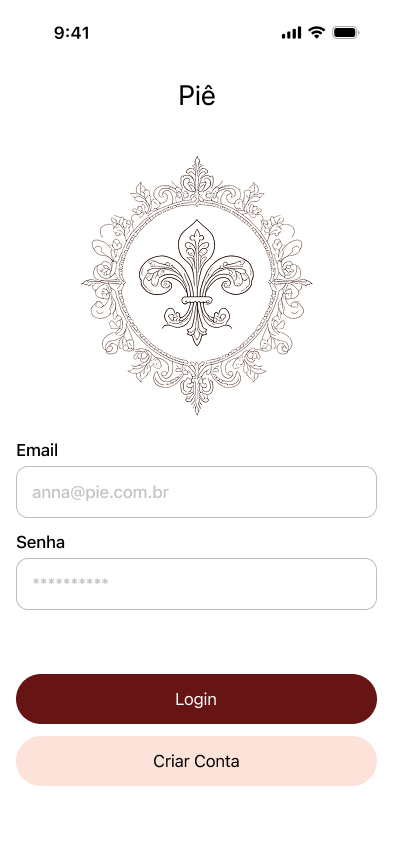
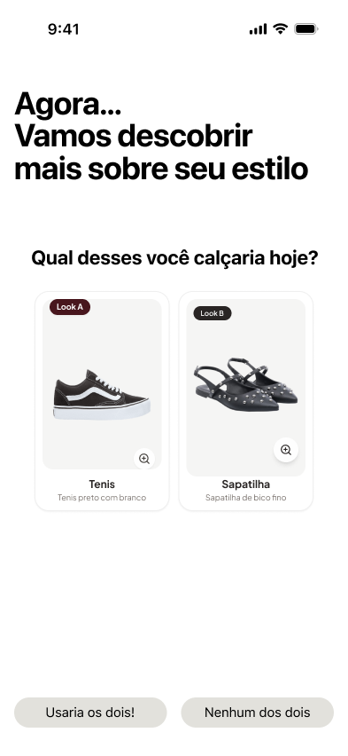
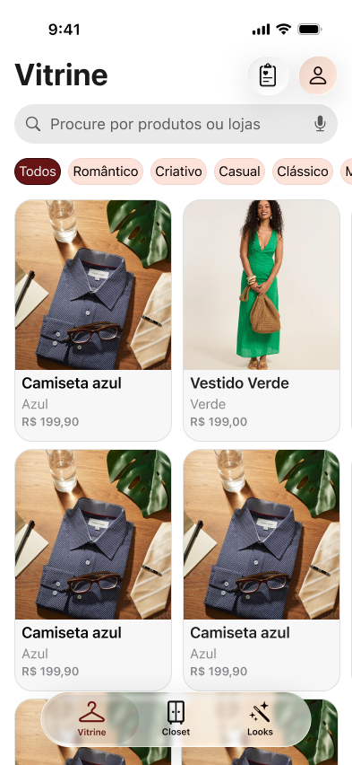
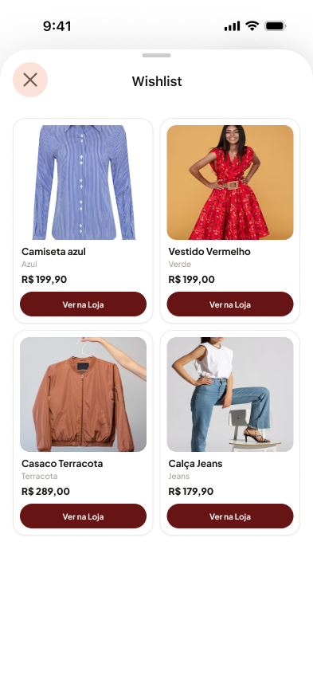
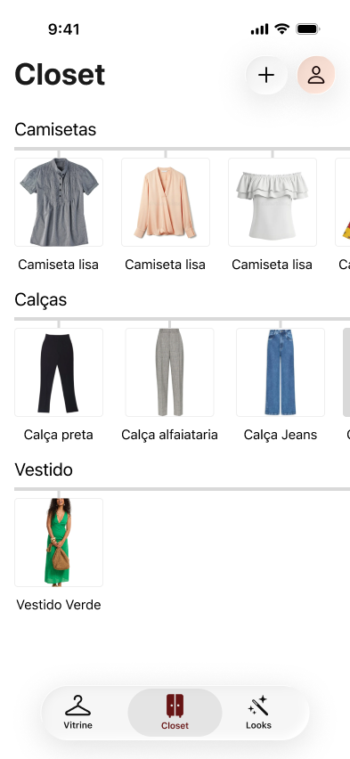
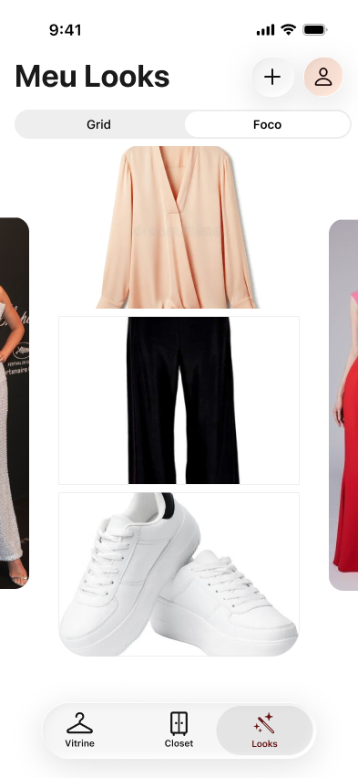
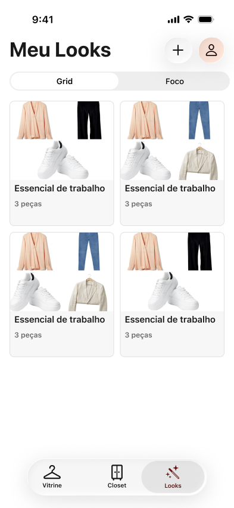

# Mockups

Mockups das telas principais do app, organizados por jornada. Cada mockup tem um link para a documentação da tela e uma lista do que **confere** e do que **difere** da versão atual do app. As diferenças também estão consolidadas em [Divergências](../divergencias.md#mockups-x-app).

| Jornada           | Tela              | Mockup                                                      | Documentação                                                                |
| ----------------- | ----------------- | ----------------------------------------------------------- | --------------------------------------------------------------------------- |
| 01 · Autenticação | Login             | [login.png](01-autenticacao/login.png)                      | [autenticacao.md](../telas/autenticacao.md#login--login)                    |
| 02 · Estilo       | Quiz de estilo    | [quiz-de-estilo.png](02-perfil-e-estilo/quiz-de-estilo.png) | [perfil-e-estilo.md](../telas/perfil-e-estilo.md#quiz-de-estilo--stylequiz) |
| 03 · Vitrine      | Vitrine           | [vitrine.png](03-vitrine/vitrine.png)                       | [vitrine.md](../telas/vitrine.md#vitrine--storefront-aba-1)                 |
| 03 · Vitrine      | Wishlist          | [wishlist.png](03-vitrine/wishlist.png)                     | [vitrine.md](../telas/vitrine.md#wishlist--wishlist-modal)                  |
| 04 · Closet       | Closet            | [closet.png](04-closet/closet.png)                          | [closet.md](../telas/closet.md#closet--closet-aba-2)                        |
| 05 · Looks        | Meus Looks — Foco | [looks-foco.png](05-looks/looks-foco.png)                   | [looks.md](../telas/looks.md#meus-looks--looks-aba-3)                       |
| 05 · Looks        | Meus Looks — Grid | [looks-grid.png](05-looks/looks-grid.png)                   | [looks.md](../telas/looks.md#meus-looks--looks-aba-3)                       |

Telas sem mockup (Cadastro, recuperação de senha, Meu estilo, Seleção de estilos, Colorimetria, Perfil e edições, Detalhes do produto, Adicionar peça, Criar Look) estão descritas apenas em texto nos documentos de [telas](../README.md#índice).

---

## 01 · Autenticação

### Login

- **Confere:** marca "Piê" e logo, campos de e-mail e senha com placeholders `anna@pie.com.br` / `**********`, botões **Login** (primário vinho) e **Criar Conta** (secundário rosado).
- **Difere:** o app rotula o campo como "E-mail" (mockup: "Email") e tem o link **Esqueceu a senha? Recuperar acesso**, que não está no mockup. O app também tem um botão de mostrar/ocultar senha.

## 02 · Perfil e Estilo

### Quiz de estilo

- **Confere:** título "Agora... Vamos descobrir mais sobre seu estilo", pergunta vinda da API, dois cartões com selo **Look A** (vinho) / **Look B** (escuro), rodapé com **Usaria os dois!** e **Nenhum dos dois**.
- **Difere:** no app, o cartão mostra só o selo, a imagem e o nome da opção. A descrição curta (ex.: "Tenis preto com branco") e o ícone de lupa do mockup não aparecem; para ver a opção ampliada, o app abre a prévia ao tocar no cartão.

## 03 · Vitrine e Recomendações

### Vitrine

- **Confere:** título "Vitrine", busca "Procure por produtos ou lojas" com ícone de microfone, chips de estilo começando em **Todos**, grade de 2 colunas com imagem, nome, cor e preço, barra de abas Vitrine / Closet / Looks com blur.
- **Difere:**
  - O atalho da Wishlist no cabeçalho é uma **prancheta** no mockup e um **coração** no app.
  - O app tem um botão de coração em cada card, que não aparece no mockup.
  - O ícone de microfone é apenas decorativo no app (não há busca por voz).
  - Os nomes dos chips vêm da taxonomia da API; o mockup mostra Romântico, Criativo, Casual, Clássico.

### Wishlist

- **Confere:** modal com **X** e título "Wishlist", grade de 2 colunas com imagem, nome, cor, preço e botão **Ver na Loja**.
- **Difere:** o app tem um botão **X** sobre a imagem de cada item, para remover, e mostra "Indisponível" no lugar de **Ver na Loja** quando o produto não está publicado. Nenhum dos dois aparece no mockup.

## 04 · Closet

### Closet

- **Confere:** título "Closet", botões **+** e Perfil, uma linha por categoria (Camisetas, Calças, Vestido…) com carrossel horizontal de peças e nome abaixo de cada uma.
- **Difere:** o app permite remover uma peça direto do card (com confirmação), o que não aparece no mockup.

## 05 · Looks

### Meus Looks — Foco

- **Confere:** alternador **Grid / Foco**, carrossel com o look em destaque no centro e os vizinhos parcialmente visíveis, peças empilhadas verticalmente.
- **Difere:**
  - O mockup traz o título "Meu Looks"; o app usa "Meus Looks".
  - Abaixo do carrossel, o app mostra nome e ocasião do look e a paginação, que não estão no mockup.

### Meus Looks — Grid

- **Confere:** grade de 2 colunas com colagem das peças (até 4), nome do look e contagem "3 peças".
- **Difere:** mesma diferença de título ("Meu Looks" × "Meus Looks"). Quando o look tem foto, o card do app vira (animação de _flip_) para mostrar a foto, comportamento que não aparece no mockup.
