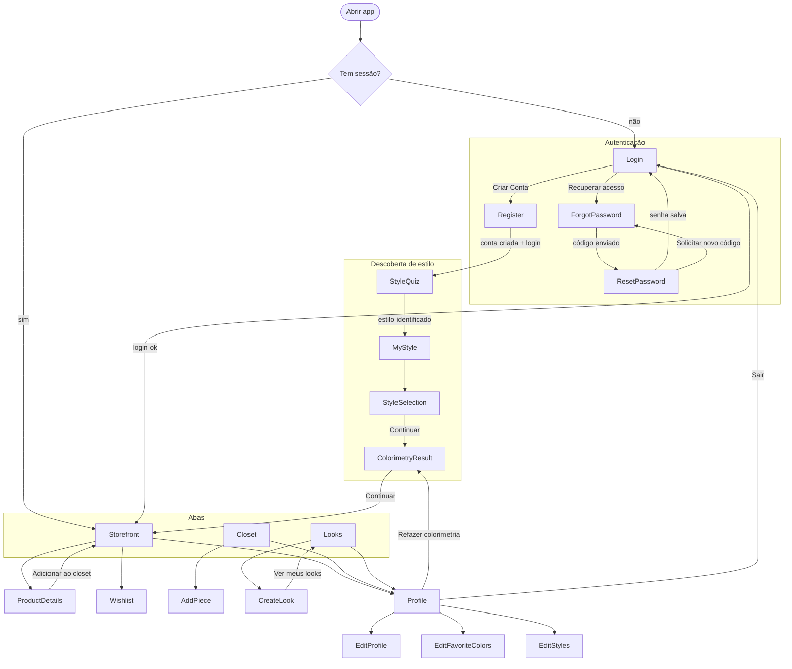

# Navegação

A navegação usa **Expo Router**: cada arquivo em `src/app/` é uma rota. Os grupos entre parênteses — `(tabs)` e `(screens)` — organizam arquivos e **não aparecem na URL**: `src/app/(screens)/Login/index.tsx` responde em `/Login`.

## Hierarquia de navigators

```text
RootLayout (src/app/_layout.tsx)
│  Providers: AuthProvider → WishlistProvider → UserStyleProvider
│  Splash animada + carregamento de fontes
│
└── Stack (sem header)
    ├── [Protegido: NÃO autenticado]
    │   ├── /Login
    │   ├── /Register
    │   ├── /ForgotPassword
    │   └── /ResetPassword            (recebe ?email=)
    │
    └── [Protegido: autenticado]
        ├── (tabs)  → Tabs customizadas (src/app/(tabs)/_layout.tsx)
        │   │  Provider: OnboardingProvider + OnboardingOverlay
        │   ├── /Storefront  "Vitrine"  (rota inicial)
        │   ├── /Closet      "Closet"
        │   └── /Looks       "Looks"    (aceita ?viewMode=focus|grid&lookId=)
        │
        ├── /Profile            (modal)
        ├── /EditProfile
        ├── /EditStyles
        ├── /EditFavoriteColors
        ├── /StyleQuiz
        ├── /MyStyle
        ├── /StyleSelection
        ├── /ColorimetryResult
        ├── /CreateLook
        ├── /AddPiece           (modal)
        ├── /ProductDetails     (modal, recebe ?productId=)
        └── /Wishlist           (modal)
```

## Rotas protegidas e redirecionamentos

O Stack raiz usa `Stack.Protected` com base no `AuthContext`:

- **Não autenticado** → só acessa Login, Cadastro e recuperação de senha.
- **Autenticado** → acessa abas e demais telas. Ao trocar o estado de autenticação, o Expo Router redireciona automaticamente para uma rota permitida.

Regras adicionais:

| Situação                                             | Destino                               | Onde                                |
| ---------------------------------------------------- | ------------------------------------- | ----------------------------------- |
| Abrir o app (`/`) sem sessão                         | `/Login`                              | `src/app/index.tsx`                 |
| Abrir o app com sessão                               | `/Storefront`                         | `src/app/index.tsx`                 |
| Cadastro concluído (`pendingStyleQuiz = true`)       | `/StyleQuiz`                          | `src/app/_layout.tsx` e `index.tsx` |
| API responde 401 (ou 404 "Usuário não encontrado")   | `signOut()` e `/Login`                | `UseSessionExpiredRedirect.ts`      |
| Enquanto a sessão é restaurada ou as fontes carregam | Nada é renderizado (splash permanece) | `RootNavigator`                     |

**Restauração de sessão:** ao iniciar, o `AuthProvider` lê o token salvo; se estiver expirado (com 30 s de folga), tenta `POST /api/auth/refresh` com o refresh token. Se falhar, limpa a sessão e o usuário cai no Login.

## Abas

As abas são montadas com `expo-router/ui` (`Tabs`, `TabList`, `TabTrigger`, `TabSlot`) e uma barra customizada ([`BottomTabBar`](../../src/components/BottomTabBar/index.tsx)) com efeito _blur_ sobre o conteúdo.

| Ordem | Rota          | Rótulo  | Ícone                                       |
| ----- | ------------- | ------- | ------------------------------------------- |
| 1     | `/Storefront` | Vitrine | `hanger` (MaterialCommunityIcons)           |
| 2     | `/Closet`     | Closet  | `wardrobe-outline` (MaterialCommunityIcons) |
| 3     | `/Looks`      | Looks   | `sparkles-outline` (Ionicons)               |

Todas as abas usam o cabeçalho [`ScreenToolBar`](../../src/components/ScreenToolBar/index.tsx), que sempre mostra o botão **Perfil** (abre `/Profile`) e ações específicas da aba (Wishlist na Vitrine, "+" no Closet e em Looks).

O **onboarding** (tour guiado de 6 passos) é um overlay renderizado dentro do layout das abas; ver [Vitrine › Onboarding](telas/vitrine.md#onboarding-tour-guiado).

## Mapa de relacionamento entre telas



## Parâmetros de rota

| Rota              | Parâmetro            | Uso                                                             |
| ----------------- | -------------------- | --------------------------------------------------------------- |
| `/ResetPassword`  | `email`              | E-mail para verificar o código; sem ele a tela pede novo código |
| `/ProductDetails` | `productId`          | ID do produto a carregar                                        |
| `/Storefront`     | `notice`             | Mensagem temporária (4 s) — ex.: peça adicionada ao closet      |
| `/Storefront`     | `status`             | Força `loading` / `empty` / `error` (testes visuais)            |
| `/Looks`          | `viewMode`, `lookId` | Modo de visualização (`focus`/`grid`) e look em foco            |

## Apresentação das telas

- **Modais** (`presentation: 'modal'`): Profile, AddPiece, ProductDetails, Wishlist. Fecham com `router.back()`.
- **Empilhadas**: demais telas. Fluxos que não devem permitir voltar usam `router.replace` (ex.: fim do quiz, fim da colorimetria) ou `router.dismissTo` (ex.: voltar ao Login após redefinir senha).
