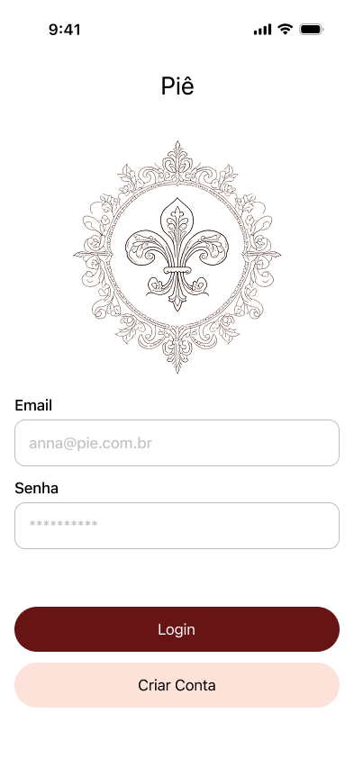

# Telas — Autenticação

Jornada de entrada no app: login, criação de conta e recuperação de senha. Todas ficam no grupo de rotas **não autenticadas** (ver [Navegação](../navegacao.md)).

Mockup: [Login](../mockups/README.md#login) — demais telas desta jornada não têm mockup.

---

## Login — `/Login`

**Arquivo:** `src/app/(screens)/Login/index.tsx` · **Hook:** `UseLoginForm.ts`

**Objetivo:** autenticar a usuária e dar acesso às abas.

**Componentes principais:** marca "Piê" + logo, `AuthInput` (e-mail), `AuthPasswordInput` (senha com mostrar/ocultar), `AuthButton` (primário e secundário), link "Recuperar acesso".

| Ação                                   | Resultado                                                 |
| -------------------------------------- | --------------------------------------------------------- |
| **Login**                              | Valida o formulário e chama `signIn` → abre `/Storefront` |
| **Criar Conta**                        | `/Register`                                               |
| **Esqueceu a senha? Recuperar acesso** | `/ForgotPassword`                                         |

**Entradas:** e-mail (obrigatório, formato válido) e senha (obrigatória).
**Saídas:** sessão (`accessToken`, `refreshToken`, `expiresIn`, `userId`) gravada em armazenamento seguro.

**Estados:**

- _Carregando:_ botão Login com spinner; campos e demais botões desabilitados.
- _Erro de validação:_ mensagem abaixo de cada campo ("Informe o e-mail.", "Por favor, insira um e-mail válido.", "Informe a senha.").
- _Erro de API:_ mensagem do servidor ou "Não foi possível entrar."; sem conexão: "Não foi possível conectar. Verifique sua conexão e tente novamente."

**Endpoint:** `POST /api/auth/login`

---

## Cadastro — `/Register`

**Arquivo:** `src/app/(screens)/Register/index.tsx` · **Hook:** `UseRegisterForm.ts`

**Objetivo:** criar a conta e iniciar a jornada de descoberta de estilo.

**Componentes:** título "Cadastro", logo de fundo com 8% de opacidade, `AuthInput` (Nome, Email), `AuthPasswordInput` (Senha, Confirmar Senha), `AuthButton` "Criar conta".

**Entradas e validação:**

| Campo           | Regra                                                    |
| --------------- | -------------------------------------------------------- |
| Nome            | obrigatório                                              |
| Email           | obrigatório, formato válido                              |
| Senha           | mínimo 6 caracteres                                      |
| Confirmar Senha | obrigatório e igual à senha ("As senhas não coincidem.") |

**Fluxo:**

1. `POST /api/users` cria a conta.
2. `completeSignUp` marca `pendingStyleQuiz = true` e faz login (`POST /api/auth/login`).
3. O layout raiz redireciona para **`/StyleQuiz`**.

**Estados:** carregando (spinner no botão); erro ao criar ("Ocorreu um erro ao criar a conta…" ou mensagem do servidor, ex.: e-mail já cadastrado); conta criada mas login falhou ("Conta criada, mas não foi possível iniciar sua sessão. Faça login para continuar.").

---

## Recuperar acesso — `/ForgotPassword`

**Arquivo:** `src/app/(screens)/ForgotPassword/index.tsx` · **Hook:** `UseForgotPasswordForm.ts`

**Objetivo:** solicitar um código de 6 dígitos por e-mail.

**Ações:** **Enviar código** (→ `/ResetPassword?email=…`) · **Voltar para o login** (`dismissTo('/Login')`).

**Estados:** carregando; erro de validação do e-mail; erro de API (mensagem do servidor ou "Não foi possível enviar o código.").

**Endpoint:** `POST /api/auth/recover`

---

## Verificar código e Nova senha — `/ResetPassword`

**Arquivo:** `src/app/(screens)/ResetPassword/index.tsx` · **Hooks:** `UseRecoveryCodeForm.ts`, `UseResetPasswordForm.ts`

Uma única rota com **três etapas** internas:

| Etapa                | Quando aparece                   | Conteúdo / ações                                                                                          |
| -------------------- | -------------------------------- | --------------------------------------------------------------------------------------------------------- |
| **Sem e-mail**       | Rota aberta sem `?email=`        | Aviso + **Solicitar novo código** (→ `/ForgotPassword`)                                                   |
| **Verificar código** | Com e-mail, antes da verificação | Campo "Código" (6 dígitos, teclado numérico, autofill de OTP). **Verificar código** / **Reenviar código** |
| **Nova senha**       | Após código válido               | Senha + Confirmar Senha. **Salvar senha**                                                                 |

**Saída final:** senha atualizada, sessão temporária de recuperação revogada, retorno ao Login com alerta "Senha redefinida!".

**Estados importantes:**

- _Reenvio:_ spinner no botão secundário; sucesso exibe "Novo código solicitado. Confira seu e-mail."
- _Código expirado (401 ao salvar):_ "Seu código expirou. Volte e solicite um novo código."

**Endpoints:** `POST /api/auth/recover/verify` (retorna token de recuperação) · `PUT /api/auth/password` (com o token de recuperação) · `POST /api/auth/logout` (revoga o token) · `POST /api/auth/recover` (reenviar).
