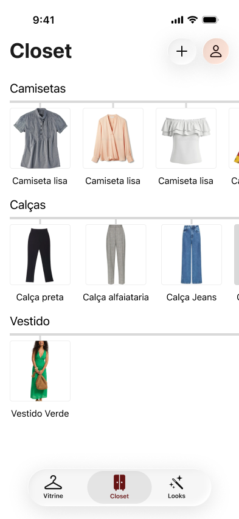
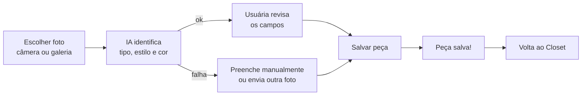

# Telas — Closet (guarda-roupa)

O **Closet** é o guarda-roupa digital: reúne as peças que a usuária já possui, cadastradas por foto ou adicionadas a partir da Vitrine. Essas peças são a matéria-prima do montador de [Looks](looks.md).

Mockup: [Closet](../mockups/README.md#closet) — Adicionar peça não tem mockup.

---

## Closet — `/Closet` (aba 2)

**Arquivo:** `src/app/(tabs)/Closet.tsx` · **Hook:** `UseWardrobeRows.ts` · **Utils:** `wardrobe-rows.ts` (store + reducer)

**Objetivo:** visualizar e organizar as peças por categoria.

**Componentes:** `ScreenToolBar` (título "Closet", botão **+ Adicionar peça**, Perfil); uma `CategoryRow` por categoria, com carrossel horizontal de `ClothingCard`.

**Ações:**

| Ação                        | Resultado                                       |
| --------------------------- | ----------------------------------------------- |
| **+** no cabeçalho          | `/AddPiece`                                     |
| Remover peça (no card)      | Confirmação "Remover do closet" → exclui a peça |
| Rolar uma linha até o fim   | Carrega mais peças da categoria                 |
| Tentar novamente (na linha) | Recarrega somente aquela categoria              |

A lista é recarregada sempre que a aba volta ao foco (por exemplo, depois de adicionar uma peça).

**Estados:** _Carregando_ ("A carregar o seu guarda-roupa..."), _Erro_ ("Ocorreu um erro ao carregar as peças." + **Tentar novamente**), _Vazio_ ("O seu guarda-roupa está vazio."), _Sucesso_, _Erro por linha_, _Erro ao remover_ (alerta "Não foi possível remover").

Peças sem nome usam `categoria · cor`; sem categoria, entram em "Outros". Se a API responder 404 ao excluir, a peça é removida da tela mesmo assim.

**Endpoints:** `GET /api/users/me/wardrobe/items` · `DELETE /api/users/me/wardrobe/items/{id}`.

---

## Adicionar peça — `/AddPiece` (modal)

**Arquivo:** `src/app/(screens)/AddPiece/index.tsx` · **Hook:** `UseAddPieceForm.ts` · **Schema:** `wardrobeSchema.ts`

**Objetivo:** cadastrar uma peça a partir de uma foto, com preenchimento assistido por IA.

**Componentes:** cabeçalho "Adicionar Peça" com fechar; `ImagePickerArea`; `FormInput` (Nome); `FormSelect` (Peça, Estilo, Cor) com _sheet_ de opções; `AuthButton` "Salvar peça".

**Fluxo:**

**Entradas:**

| Campo       | Regra                                                                 |
| ----------- | --------------------------------------------------------------------- |
| Foto        | obrigatória; JPEG, PNG ou WebP; até 3,75 MB para análise; recorte 4:3 |
| Nome        | obrigatório                                                           |
| Peça        | obrigatório (categorias da taxonomia)                                 |
| Estilo, Cor | opcionais (pré-preenchidos pela IA)                                   |

**Ações:** tocar na área da foto (no celular: **Tirar Foto** / **Escolher da Galeria** / **Cancelar**; na web: galeria direto), selecionar opções, **Enviar outra foto** (após falha), **Salvar peça**, fechar.

**Estados:**

- _Analisando:_ spinner "Identificando tipo, estilo e cor da peça..." e campos bloqueados.
- _Análise concluída:_ "Confira os dados identificados antes de salvar."
- _Falha na análise:_ mensagem + "Envie outra foto com boa iluminação ou preencha os campos manualmente."
- _Taxonomia indisponível:_ "Não foi possível carregar as opções. Tente novamente." / alerta "Opções indisponíveis".
- _Permissão de câmera negada:_ alerta "Permissão necessária".
- _Salvando:_ botão em loading. _Sucesso:_ alerta "Peça salva!" e retorno.

**Endpoints:** `GET /api/taxonomy` · `POST /api/users/me/wardrobe/items/analyze` (multipart) · `POST /api/users/me/wardrobe/items` (multipart: `file` + `item` JSON).
