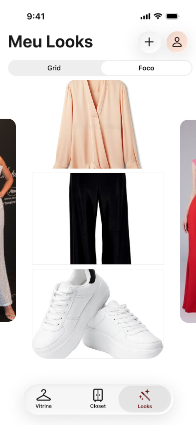
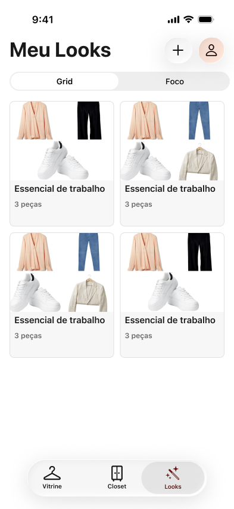
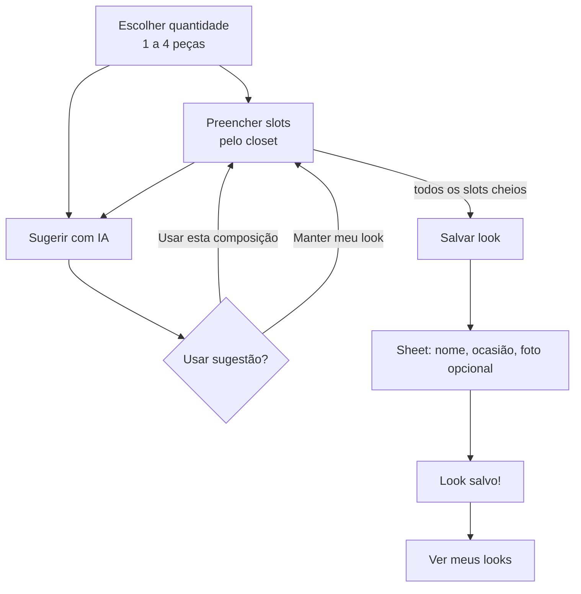

# Telas — Looks

O montador de looks combina peças do closet em composições de 1 a 4 peças, com ajuda opcional da IA, e mantém uma galeria dos looks criados.

Mockups: [Meus Looks — Foco](../mockups/README.md#meus-looks--foco) · [Meus Looks — Grid](../mockups/README.md#meus-looks--grid) — Criar Look não tem mockup.

---

## Meus Looks — `/Looks` (aba 3)

**Arquivo:** `src/app/(tabs)/Looks.tsx` · **Hooks:** `UseLooksCollection.ts`, `UseLookFocusNavigation.ts`

 

**Objetivo:** navegar pelos looks criados.

**Componentes:** `ScreenToolBar` (título "Meus Looks", **+ Criar look**, Perfil); `LooksViewModeToggle` (Grid / Foco); no modo **Foco**, `LookFocusCarousel` (cartões com `LookFlipCard`/`LookPiecesStack`), `LookFocusInfo` (título e ocasião) e `LookFocusPagination`; no modo **Grid**, `LooksGrid` com `LookCard`.

**Ações:**

| Ação                   | Resultado                                                    |
| ---------------------- | ------------------------------------------------------------ |
| **+** no cabeçalho     | `/CreateLook`                                                |
| Alternar Grid / Foco   | Troca o modo (com _fade_) e grava `viewMode`/`lookId` na URL |
| Deslizar no carrossel  | Muda o look em foco; no último, carrega a próxima página     |
| Tocar look no Grid     | Volta ao modo Foco no look escolhido                         |
| Adicionar foto do look | Galeria → envia a foto e atualiza o cartão                   |

**Estados:** _Carregando_ ("Carregando looks..."), _Erro_ ("Não foi possível carregar os looks" + **Tentar novamente**), _Vazio_ ("Você ainda não tem looks — Monte seu primeiro look para vê-lo aqui."), _Sucesso_, _Carregando mais_ (spinner), _Erro de paginação_ ("Tentar carregar mais looks"). Recarrega ao voltar ao foco.

**Endpoints:** `GET /api/users/me/looks?page&size=20&sort=createdAt,DESC` · `POST /api/users/me/looks/{id}/image`.

---

## Criar Look — `/CreateLook`

**Arquivo:** `src/app/(screens)/CreateLook/index.tsx` · **Hooks:** `UseLookForm.ts`, `UseWardrobe.ts` · **Schema:** `lookSchema.ts`

**Objetivo:** montar e salvar um look com peças do closet.

**Componentes:** cabeçalho "Criar Look — Selecione peças do seu closet para montar seu look"; área de composição com _slots_ (layout em coluna para 1–3 peças e grade 2+2 para 4); `WardrobePickerModal` (escolher peça); modal de quantidade; modal de sugestão da IA com `LookPieceCard`; `SaveLookSheet` (nome, ocasião, foto); modal de sucesso.

**Fluxo:**

**Ações:**

| Ação                                               | Resultado                                                                                                                             |
| -------------------------------------------------- | ------------------------------------------------------------------------------------------------------------------------------------- |
| "+" (sem quantidade) / "N peças · Alterar"         | Abre "Quantas peças terá o look?"; reduzir com peças preenchidas pede confirmação                                                     |
| "+" em um slot                                     | Abre o seletor de peças do closet (peças já usadas ficam bloqueadas)                                                                  |
| Lixeira no slot                                    | Remove a peça                                                                                                                         |
| **Sugerir look com IA** / **Sugerir peças com IA** | Busca sugestão para os slots vazios (pede a quantidade antes, se necessário); ver [Como a sugestão é feita](#como-a-sugestão-é-feita) |
| **Salvar look**                                    | Habilitado só com todos os slots preenchidos; abre o sheet de salvamento                                                              |

**Entradas (sheet):** Nome do look (obrigatório, ex.: "Ir para faculdade"), Ocasião (opcional, ex.: "Trabalho, Casual, Festa"), Foto do look (opcional).
**Saídas:** look criado com as peças na ordem definida; foto enviada se escolhida.

**Estados:**

- _Sugerindo:_ botão de IA em loading.
- _Sem peças para sugerir:_ "Não há peças disponíveis para sugerir. Adicione peças ao seu closet."
- _Closet vazio/erro no seletor:_ "Você ainda não tem peças no guarda-roupa." / "Não foi possível carregar suas peças." + Tentar novamente.
- _Salvando:_ sheet em loading.
- _Look criado mas foto falhou:_ "O look foi criado, mas não foi possível enviar a foto." (nova tentativa reaproveita o look criado, sem duplicar).
- _Sucesso:_ modal "Look salvo! Seu look foi criado com sucesso." → **Ver meus looks**.

**Endpoints:** `GET /api/users/me/wardrobe/items` · `GET /api/users/me/looks/suggestion` · `POST /api/users/me/looks` · `POST /api/users/me/looks/{id}/image`.

### Como a sugestão é feita

Apesar do rótulo "com IA", a sugestão é calculada por regras no backend (`GET /api/users/me/looks/suggestion`), sem modelo de IA:

1. Junta as peças do closet da usuária e os produtos publicados da Vitrine.
2. Descarta peças nas **cores a evitar** da colorimetria.
3. Dá mais pontos às peças nos **estilos** e nas **cores favoritas e de destaque** da usuária; empates são embaralhados para variar a sugestão.
4. Escolhe no máximo **uma peça por categoria**, até 4 peças.

Por isso o look sugerido pode conter **produtos das lojas parceiras**, mesmo que a tela fale em "peças do seu closet".
