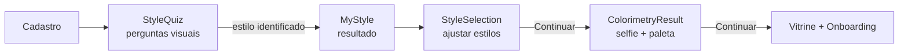
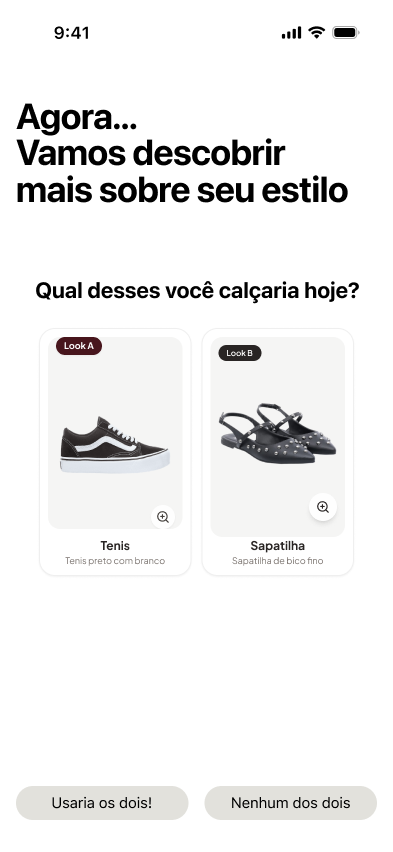

# Telas — Perfil e Estilo

Cobre a **descoberta de estilo** (feita logo após o cadastro) e a **área de Perfil**, onde a usuária revê e edita seus dados, colorimetria, cores e estilos favoritos.

Mockup: [Quiz de estilo](../mockups/README.md#quiz-de-estilo) — demais telas desta jornada não têm mockup.

## Jornada de descoberta de estilo (pós-cadastro)

> Atenção: **MyStyle** e **StyleSelection** ainda usam dados mockados (ver [Divergências](../divergencias.md)).

---

## Quiz de estilo — `/StyleQuiz`

**Arquivo:** `src/app/(screens)/StyleQuiz/index.tsx` · **Hook:** `UseStyleQuiz.ts` · **Utils:** `style-identification.ts`, `style-quiz-answers.ts`

**Objetivo:** identificar o estilo predominante por meio de perguntas com duas imagens cada.

**Componentes:** título "Agora... Vamos descobrir mais sobre seu estilo", pergunta atual, `StyleQuizOptionCard` (uma por opção), `StyleQuizFooter` (respostas alternativas), `StyleQuizChoicePreview` (pré-visualização para confirmar a escolha).

**Ações:**

| Ação                                      | Resultado                                                         |
| ----------------------------------------- | ----------------------------------------------------------------- |
| Tocar em uma opção                        | Abre a pré-visualização da escolha                                |
| **Usaria os dois!** / **Nenhum dos dois** | Respostas alternativas (`both` / `none`) via rodapé               |
| **Continuar** (na prévia)                 | Grava a resposta e avança; na última pergunta, envia e identifica |
| **Voltar e escolher novamente**           | Fecha a prévia                                                    |

**Entradas:** perguntas ordenadas por `order` (`GET /api/style/questions`).
**Saídas:** respostas (`POST /api/users/me/style/answers`) e estilo identificado (`POST /api/users/me/style/identify`), guardado no `UserStyleContext`; `pendingStyleQuiz` passa a `false`; navegação com `replace` para `/MyStyle`.

**Estados:**

- _Carregando perguntas:_ spinner.
- _Identificando:_ spinner com "Identificando seu estilo...".
- _Erro na identificação:_ mensagem + **Tentar novamente** / **Alterar respostas** (volta à 1ª pergunta).
- _Erro ao carregar o quiz:_ "Não foi possível carregar o questionário."
- _Sessão expirada:_ `signOut` e retorno ao Login.

---

## Meu estilo — `/MyStyle`

**Arquivo:** `src/app/(screens)/MyStyle/index.tsx`

**Objetivo:** apresentar o resultado do quiz: estilo principal "por essência, com toques" de dois estilos secundários, sobre imagem de fundo do estilo principal (status bar clara).

**Ação:** botão para **StyleSelection**.

**Implementação atual:** lê `mockUserIdentifiedStyles` de `src/mocks/styleMocks.ts`, **não** o estilo retornado pela API.

---

## Seleção de estilos — `/StyleSelection`

**Arquivo:** `src/app/(screens)/StyleSelection/index.tsx`

**Objetivo:** permitir ajustar os estilos com que a usuária se identifica ("Escolha um estilo para começar. Você pode ajustar os detalhes depois.").

**Comportamento:** lista de botões de estilo (multi-seleção, mínimo de 1). O fundo troca com animação de _fade/scale_ para o último estilo selecionado.

**Ação:** **Continuar** → `/ColorimetryResult`.

**Implementação atual:** opções e seleção inicial vêm de mocks; a seleção **não é enviada** à API.

---

## Colorimetria — `/ColorimetryResult`

**Arquivo:** `src/app/(screens)/ColorimetryResult/index.tsx` · **Hook:** `UseColorimetryPreferences.ts`

**Objetivo:** analisar a selfie com IA e apresentar a paleta da usuária; permitir escolher até 4 cores favoritas.

Acessada no fim da jornada de estilo e pelo Perfil ("Refazer colorimetria").

**Etapas e estados:**

| Etapa             | Conteúdo / ações                                                                                                                                           |
| ----------------- | ---------------------------------------------------------------------------------------------------------------------------------------------------------- |
| **Captura**       | "E por fim... As cores que combinam com você", ícone de câmera, instrução de foto. **Tirar foto**                                                          |
| **Consentimento** | Modal `ColorimetryConsentModal` ("Antes da foto"): **Concordo e tirar foto** / **Agora não**. Exibido uma vez por visita                                   |
| **Permissão**     | Câmera frontal. Negada: "Permita o acesso à câmera para tirar sua foto."                                                                                   |
| **Analisando**    | Foto capturada + spinner "Preparando sua paleta de cores..." (mínimo de 4 s)                                                                               |
| **Erro**          | Mensagem do servidor ou "Não foi possível carregar sua colorimetria." + **Tentar novamente** / **Tirar outra foto**                                        |
| **Resultado**     | "Sua estação: …", **Suas cores de destaque**, **Cores a evitar perto do rosto**, **Escolha suas Cores Favoritas** (slots editáveis com `ColorPickerModal`) |

**Ações no resultado:** tocar slot (escolher cor), remover cor, **Continuar** (salva favoritas se alteradas e vai para `/Storefront`), **Refazer colorimetria** (volta à captura).

**Regras:** máximo de 4 cores favoritas; cores duplicadas são recusadas ("Essa cor já está nas suas favoritas.").

**Endpoints:** `POST /api/users/me/colorimetry` (multipart com a foto) · `PUT /api/users/me/preferences` (`favoriteColors`).

---

## Perfil — `/Profile` (modal)

**Arquivo:** `src/app/(screens)/Profile/index.tsx` · **Hooks:** `UseCurrentUser.ts`, `UseProfilePreferences.ts`, `UseFavoriteStyles.ts`

**Objetivo:** concentrar dados pessoais e preferências de estilo. Aberto pelo ícone de usuário do cabeçalho das abas.

**Seções:**

| Seção            | Componente            | Ação                               |
| ---------------- | --------------------- | ---------------------------------- |
| Dados da usuária | `ProfileUserSection`  | **Editar perfil** → `/EditProfile` |
| Colorimetria     | `ProfileColorSection` | **Refazer** → `/ColorimetryResult` |
| Cores Favoritas  | `ProfileColorSection` | **Editar** → `/EditFavoriteColors` |
| Estilos          | `ProfileStyleSection` | **Editar** → `/EditStyles`         |
| Rodapé           | `ProductActionButton` | **Sair** (logout)                  |

**Estados por seção** (`ProfileSectionStatus`): carregando, erro com **Tentar novamente**, vazio ("Você ainda não fez sua colorimetria.", "Nenhuma cor favorita cadastrada.", "Faça o quiz de estilo para descobrir seus estilos.") e sucesso. Os dados são recarregados sempre que a tela volta ao foco. Sessão expirada → Login.

**Endpoints:** `GET /api/users/me` · `GET /api/users/me/preferences` · `GET /api/users/me/style` · `POST /api/auth/logout`.

---

## Editar perfil — `/EditProfile`

**Arquivo:** `src/app/(screens)/EditProfile/index.tsx` · **Hook:** `UseEditProfile.ts`

**Campos:** foto (galeria, recorte 1:1), **Nome** (editável, obrigatório) e **Email** (somente leitura).

**Ação:** **Salvar Alterações** → `PUT /api/users/{id}` e volta. Se o carregamento falhou, o botão passa a tentar recarregar.

**Estados:** erro de carregamento ("Não foi possível carregar seus dados."), erro ao salvar, permissão de galeria negada (alerta), sessão expirada.

> A foto escolhida é apenas exibida localmente; ela **não é enviada** à API (ver [Divergências](../divergencias.md)).

---

## Editar estilos — `/EditStyles`

**Arquivo:** `src/app/(screens)/EditStyles/index.tsx` · **Hook:** `UseEditFavoriteStyles.ts`

**Objetivo:** escolher os estilos favoritos em uma grade (`StyleOptionGrid`). Opções: Casual, Elegante, Esportivo, Romântico, Minimalista e Boho.

**Ações:** alternar estilos (mínimo 1 para salvar), **Salvar** (`PUT /api/users/me/style`), fechar (X).

**Estados:** carregando (botão em loading), erro de carga/salvamento, sessão expirada.

---

## Editar cores favoritas — `/EditFavoriteColors`

**Arquivo:** `src/app/(screens)/EditFavoriteColors/index.tsx` · **Hook:** `UseEditFavoriteColors.ts`

**Objetivo:** editar até 4 cores favoritas em slots (`ColorimetryColorRow` + `ColorPickerModal`).

**Ações:** tocar slot para escolher cor, remover cor, **Salvar** (`PUT /api/users/me/preferences`), fechar (X).

**Estados:** carregando, cor duplicada, limite excedido, erro ao salvar, sessão expirada. **Endpoint de leitura:** `GET /api/users/me/preferences`.
