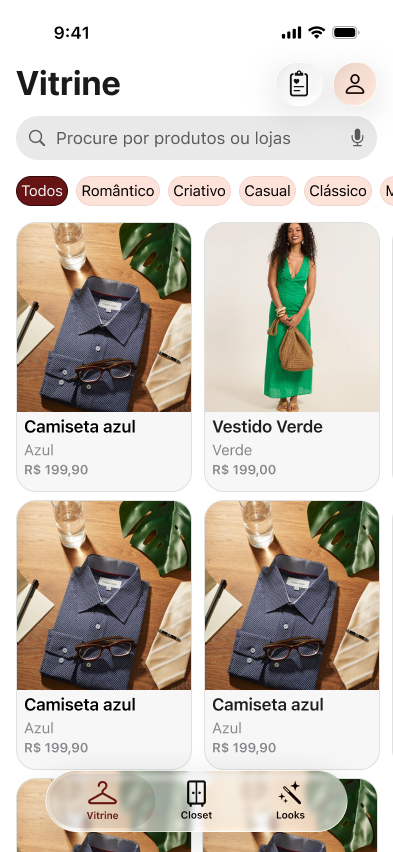
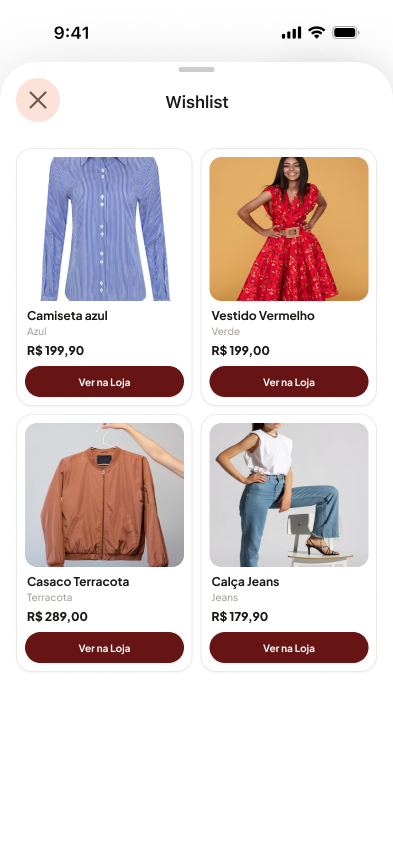

# Telas — Vitrine e Recomendações

A **Vitrine** (`/Storefront`) é a aba inicial do app: lista o catálogo de peças das lojas parceiras, com busca e filtros por estilo, peça, cor, loja e material. A partir dela a usuária abre os detalhes do produto, salva peças na Wishlist e adiciona ao closet as peças que já tem.

> **Recomendações:** na versão atual, a Vitrine **não é personalizada**. Ela mostra o catálogo público, ordenado por nome, e a usuária refina com busca e filtros. A API já oferece recomendações por perfil (`GET /api/products/recommendations`, que pontua os produtos pelos estilos e cores favoritas da usuária), mas o app ainda não usa esse endpoint. Hoje, a recomendação que chega à usuária é a **sugestão de look** do montador de [Looks](looks.md#como-a-sugestão-é-feita), que pode incluir produtos da Vitrine.

Mockups: [Vitrine](../mockups/README.md#vitrine) · [Wishlist](../mockups/README.md#wishlist)

---

## Vitrine — `/Storefront` (aba 1)

**Arquivo:** `src/app/(tabs)/Storefront.tsx` · **Hooks:** `UseStorefrontCatalog.ts`, `UseStorefrontFilters.ts`, `UseStorefrontNotice.ts`, `UseTaxonomy.ts`

**Objetivo:** descobrir peças e chegar ao produto.

**Componentes principais:**

| Componente              | Papel                                                                                                              |
| ----------------------- | ------------------------------------------------------------------------------------------------------------------ |
| `ScreenToolBar`         | Título "Vitrine", botão **Wishlist** (coração) e botão **Perfil**                                                  |
| `StorefrontSearchBar`   | Busca por texto com _debounce_ de 300 ms e botão limpar                                                            |
| `StorefrontFilterChips` | Chips horizontais: **Todos**, um chip por estilo e **Mais filtros**                                                |
| `StorefrontFilterSheet` | _Bottom sheet_ "Filtros" com grupos Estilos, Peças de Roupa, Cores, Lojas, Materiais; **Limpar filtros** e aplicar |
| `StorefrontNotice`      | Faixa de aviso temporária (4 s), ex.: "“Vestido” foi adicionada ao seu closet!"                                    |
| `StorefrontProductGrid` | Grade de 2 colunas com scroll infinito e _pull-to-refresh_                                                         |
| `StorefrontProductCard` | Imagem, nome e botão de coração (adiciona/remove da Wishlist)                                                      |

**Ações:**

| Ação                     | Resultado                                                     |
| ------------------------ | ------------------------------------------------------------- |
| Digitar na busca         | Recarrega o catálogo (página 0) após 300 ms                   |
| Tocar chip de estilo     | Aplica/remove o filtro imediatamente                          |
| **Mais filtros**         | Abre o sheet com rascunho dos filtros; aplica só ao confirmar |
| Tocar no card            | `/ProductDetails?productId=…`                                 |
| Tocar no coração do card | Alterna a peça na Wishlist                                    |
| Rolar até o fim          | Carrega a próxima página (20 itens)                           |
| Puxar para baixo         | Atualiza a lista                                              |

**Entradas:** termos de taxonomia e lojas ativas (para montar filtros), parâmetros de URL `notice` e `status`.
**Saídas:** navegação para detalhes / Wishlist / Perfil; alterações na Wishlist (em memória).

Busca e filtros aplicados ficam em cache em memória do módulo, então são mantidos ao trocar de aba.

**Estados:** _Carregando_ ("Carregando produtos..."), _Erro_ ("Não foi possível carregar a storefront" + **Tentar novamente**), _Vazio_ ("Nenhum produto encontrado — Tente ajustar os filtros ou volte mais tarde."), _Sucesso_ (grade), _Carregando mais_ (indicador no fim da lista).

**Endpoints:** `GET /api/products?search&styles&categories&colors&companies&materials&page&size=20&sort=name,ASC` · `GET /api/taxonomy` · `GET /api/companies/active`.

---

## Detalhes do produto — `/ProductDetails` (modal)

**Arquivo:** `src/app/(screens)/ProductDetails/index.tsx` · **Hooks:** `UseProductDetails.ts`, `UseAddToWardrobe.ts`

**Objetivo:** apresentar a peça e levar à ação: adicionar ao closet ou comprar na loja parceira.

**Componentes:** `ProductHeader` (fechar, título, coração da Wishlist), `ProductImageCarousel`, seções **Descrição**, **Tamanho** (`ProductSizeSelector`, se houver tamanhos), **Preço** (BRL), **Loja**; rodapé com `ProductActionButton`.

**Ações:**

| Ação                              | Resultado                                                                                       |
| --------------------------------- | ----------------------------------------------------------------------------------------------- |
| **Já tenho! Adicionar ao closet** | Cria item no guarda-roupa com a imagem do produto e volta à Vitrine com aviso                   |
| **Comprar na loja {Loja}**        | Abre `purchaseUrl` no navegador interno ("Você será direcionado para o site da loja parceira.") |
| Coração no cabeçalho              | Alterna na Wishlist                                                                             |
| Fechar (X)                        | `router.back()`                                                                                 |

**Estados:**

- _Carregando produto:_ spinner central.
- _Erro / produto inexistente:_ "Não foi possível carregar este produto."
- _Verificando closet:_ botão principal em loading enquanto consulta se a peça já está no guarda-roupa.
- _Já no closet:_ botão "Esta peça já está no seu closet" (variante `done`, desabilitado).
- _Indisponível:_ "Este produto não está mais disponível para compra."; botão de compra oculto.
- _Erro ao adicionar / abrir loja:_ mensagem acima dos botões.

**Endpoints:** `GET /api/products/{id}/public` · `GET /api/users/me/wardrobe/items` (verificação) · `POST /api/users/me/wardrobe/items` (adicionar).

---

## Wishlist — `/Wishlist` (modal)

**Arquivo:** `src/app/(screens)/Wishlist/index.tsx` · **Contexto:** `WishlistContext.tsx`

**Objetivo:** listar as peças salvas como desejo.

**Componentes:** cabeçalho com fechar e título "Wishlist"; grade de 2 colunas com `WishlistCard` (imagem, nome, cor, preço, botão remover).

**Ações:** **Ver na Loja** (abre `purchaseUrl`), remover (X), fechar; no estado vazio, **Explorar Vitrine**.

**Estados:** _Vazio_ ("Sua lista de desejos está vazia"), _Item indisponível_ (imagem esmaecida + rótulo "Indisponível" no lugar do botão), _Com itens_.

**Endpoints:** nenhum — a Wishlist é mantida **apenas em memória** (ver [Divergências](../divergencias.md)).

---

## Onboarding (tour guiado)

**Arquivos:** `src/components/OnboardingOverlay`, `OnboardingTooltip` · `src/contexts/OnboardingContext.tsx` · `src/constants/OnboardingSteps.ts`

**Objetivo:** apresentar as áreas do app na primeira vez que a usuária chega às abas.

**Quando aparece:** sempre que o progresso salvo da usuária for `in_progress` (inclusive no primeiro acesso) e não houver quiz pendente. O progresso é salvo por usuária (`pie_onboarding_progress.<userId>`), então o tour retoma do passo em que parou.

**Comportamento:** desfoca o conteúdo, destaca o elemento-alvo (_spotlight_) e mostra um tooltip com **Voltar**, **Próximo →** / **Começar →** e **Pular**. Ao concluir ou pular, marca como `completed` e vai para a Vitrine.

| #   | Passo                   | Elemento destacado         |
| --- | ----------------------- | -------------------------- |
| 1   | Vitrine de Peças        | Aba Vitrine                |
| 2   | Seu Closet Digital      | Aba Closet                 |
| 3   | Montador de Looks       | Aba Looks                  |
| 4   | Filtros por Estilo      | Chips de filtro da Vitrine |
| 5   | Seu Perfil e Estilo     | Botão Perfil               |
| 6   | Seus Desejos & Wishlist | Botão Wishlist             |

Elementos se registram como alvo com o hook `useOnboardingTarget(id, renderSpotlight)`.
